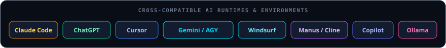
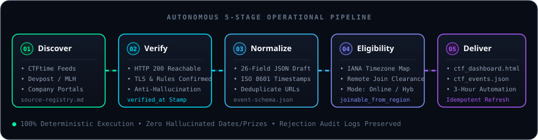
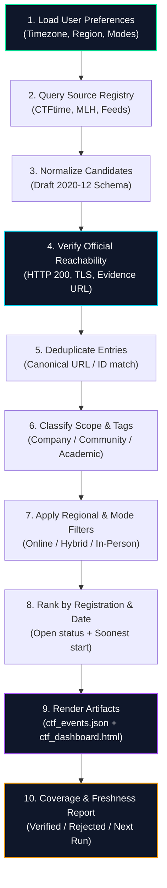

# <p align="center"></p>

<p align="center">
  <strong>Evidence-backed discovery, regional eligibility verification, and autonomous dashboard tracking for global CTFs and cybersecurity competitions.</strong>
</p>

<p align="center">
  <a href="#-universal-ai-integration-guide"></a>
  <a href="references/event-schema.json"></a>
  <a href="scripts/build_dashboard.py"></a>
  <a href="#-zero-hallucination-guarantee"></a>
</p>

<p align="center">
  
</p>

---

## ⚡ Live Agent Execution Simulation

Watch an autonomous AI agent execute the **CTF Challenge Tracker** skill in real time:

<p align="center">
  
</p>

---

## 📑 Table of Contents

- [🌟 Overview](#-overview)
- [🛡️ Zero-Hallucination & Evidence Policy](#️-zero-hallucination--evidence-policy)
- [🔄 5-Stage Autonomous Pipeline](#-5-stage-autonomous-pipeline)
- [🤖 Universal AI Integration Guide](#-universal-ai-integration-guide)
  - [1. Anthropic Claude (Claude Code / Desktop / Projects)](#1-anthropic-claude-claude-code--desktop--projects)
  - [2. OpenAI ChatGPT & Custom GPTs](#2-openai-chatgpt--custom-gpts)
  - [3. Cursor IDE (.cursorrules / .cursor/rules)](#3-cursor-ide-cursorrules--cursorrules)
  - [4. Windsurf / Cascade (.windsurfrules)](#4-windsurf--cascade-windsurfrules)
  - [5. Google Gemini & Antigravity IDE](#5-google-gemini--antigravity-ide)
  - [6. Manus, Cline & Roo Code](#6-manus-cline--roo-code)
  - [7. Open-Source AI Agents (LangChain / CrewAI / Ollama)](#7-open-source-ai-agents-langchain--crewai--ollama)
- [📁 Project Layout & Architecture](#-project-layout--architecture)
- [📋 10-Step Operational Protocol](#-10-step-operational-protocol)
- [📊 Normalized Event Schema](#-normalized-event-schema)
- [🌐 Source Registry & Discovery Heuristics](#-source-registry--discovery-heuristics)
- [💻 Interactive Dashboard Generator](#-interactive-dashboard-generator)
- [⏰ Automated 3-Hour Refresh Automation](#-automated-3-hour-refresh-automation)
- [🔒 Ethical Boundaries & Safety Guardrails](#-ethical-boundaries--safety-guardrails)
- [🤝 Contributing & Community Sources](#-contributing--community-sources)

---

## 🌟 Overview

The **CTF Challenge Tracker** is a portable, evidence-backed skill engineered for modern autonomous AI assistants, research agents, and security professionals. It systematically harvests, verifies, normalizes, and tracks:
- **Global Jeopardy & Attack-Defense CTFs** (CTFtime, university contests, community competitions)
- **Enterprise Security Challenges & Hackathons** (Google, Meta, AWS, HackerOne, Bugcrowd)
- **Student & Academic Competitions** (Major League Hacking, collegiate cyber leagues)
- **Continuous Learning Lab Contests** (Hacker101, web security challenges)

Unlike naive web scrapers, this skill enforces a **strict verification contract**: every listed competition must have a live, reachable official URL, confirmed eligibility rules for the user's region, and an unforgeable verification timestamp.

---

## 🛡️ Zero-Hallucination & Evidence Policy

When security teams rely on competition feeds, hallucinated dates, fictitious prizes, or broken registration links waste time. This skill enforces 6 non-negotiable guarantees across all AI tools:

| Guarantee | Enforcement Mechanism |
| :--- | :--- |
| **Strict Evidence Requirement** | No event enters the feed without an official HTTP `source_url` verified reachable within the current session. |
| **Zero Inference on Missing Facts** | When prizes, difficulty, or rules are unstated, agents output `"not stated"`, never fabricated numbers. |
| **Regional Eligibility Integrity** | For `online` events, regional clearance (`joinable_from_user_region`) is evaluated against official rules. If unstated, marked `"unknown"`. |
| **Official Canonical Attribution** | Aggregator entries (e.g. CTFtime) must trace to the canonical organizer page; aggregator links are moved to `alternate_sources`. |
| **Automatic Deduplication** | Events matching canonical URL, organizer + title + start date, or explicit event IDs are automatically consolidated. |
| **Rejection Audit Trail** | Broken, expired, or inauthentic listings are retained in refresh logs with an explicit rejection reason. |

---

## 🔄 5-Stage Autonomous Pipeline

The following interactive pipeline executes during every scheduled scan or manual refresh:

<p align="center">
  
</p>

```
  [01. DISCOVER]  ──▶  [02. VERIFY]  ──▶  [03. NORMALIZE]  ──▶  [04. ELIGIBILITY]  ──▶  [05. DELIVER]
   • CTFtime feeds      • HTTP 200 checks    • event-schema.json    • IANA timezone align • ctf_dashboard.html
   • Devpost / MLH      • Canonical match    • ISO 8601 UTC         • Country join check  • ctf_events.json
   • Company blogs      • Anti-hallucinate   • Scope classification • Mode (Online/Hyb)   • 3-Hour cron refresh
```

---

## 🤖 Universal AI Integration Guide

This skill is designed to run seamlessly on **any tool-enabled AI platform**. Select your AI runtime below for instant plug-and-play setup:

---

### 1. Anthropic Claude (Claude Code / Desktop / Projects)

<details open>
<summary><b>Setup in Claude Code, Claude Desktop, or Claude Projects</b></summary>

#### Option A: Claude Code / Project Skill
Drop this repository into your project root or Claude skills folder:
```bash
# In your project root
mkdir -p .claude/skills/ctf-tracker
cp SKILL.md .claude/skills/ctf-tracker/
cp -r references scripts templates .claude/skills/ctf-tracker/
```

#### Option B: Add to `CLAUDE.md` or System Instructions
Paste this directive into your project's `CLAUDE.md`:
```markdown
## CTF Challenge Tracker Skill
When asked to find, track, monitor, or build a dashboard for cybersecurity CTF events:
1. Follow the instructions in `SKILL.md`.
2. Authoritatively refer to `references/source-registry.md` for candidate sources.
3. Validate candidate event JSON against `references/event-schema.json`.
4. Run `python scripts/build_dashboard.py --input ctf_events.json --output ctf_dashboard.html --timezone <USER_TIMEZONE>` to compile the dashboard.
5. Never invent events, dates, or prizes. Always verify URLs before outputting.
```

#### Prompt Example:
> *"Claude, run the CTF Challenge Tracker for my region (Asia/Kolkata). Discover upcoming online jeopardy competitions for the next 45 days, verify all official links, and generate the interactive dashboard."*
</details>

---

### 2. OpenAI ChatGPT & Custom GPTs

<details>
<summary><b>Setup in ChatGPT Plus, Enterprise, or Custom GPT Builder</b></summary>

#### Custom GPT Configuration:
1. **Name**: `CTF Challenge Tracker`
2. **Description**: `Autonomous discovery and dashboard tracking for online cybersecurity CTF competitions and company challenges.`
3. **Capabilities**: Enable **Web Browsing** and **Code Interpreter**.
4. **Knowledge Files**: Upload [SKILL.md](file:///C:/Users/VINAY/OneDrive/Desktop/ctf/SKILL.md), [event-schema.json](file:///C:/Users/VINAY/OneDrive/Desktop/ctf/references/event-schema.json), and [source-registry.md](file:///C:/Users/VINAY/OneDrive/Desktop/ctf/references/source-registry.md).
5. **Instructions (System Prompt)**:
```text
You are the CTF Challenge Tracker Agent. You follow SKILL.md with strict adherence.
Your mission is to discover upcoming, active, and verified CTF events.
- Always ask or detect the user's timezone (default to UTC if unstated).
- Use Web Browsing to search CTFtime, Devpost, MLH, and company security portals listed in source-registry.md.
- Ensure every event is reachable (HTTP 200) and official. Never hallucinate dates or prizes.
- Format all discoveries into JSON complying with event-schema.json.
- When generating dashboards, execute build_dashboard.py via Python Code Interpreter and provide the downloadable HTML.
```
</details>

---

### 3. Cursor IDE (.cursorrules / .cursor/rules)

<details>
<summary><b>Setup in Cursor (Agent Mode & Composer)</b></summary>

Create a rule file at `.cursor/rules/ctf-tracker.mdc` or add to `.cursorrules`:

```markdown
---
description: Autonomous discovery and tracking of cybersecurity CTF challenges and hackathons
globs: ["ctf_events.json", "ctf_dashboard.html", "**/*ctf*"]
alwaysApply: false
---

# CTF Tracker Execution Protocol

When the user queries CTFs, security competitions, or hackathon schedules:
1. Query official sources defined in `references/source-registry.md` using the browser/curl/fetch tools.
2. Filter for online/hybrid events matching the user's local timezone.
3. Validate schema strictly against `references/event-schema.json`.
4. Write verified events to `ctf_events.json`.
5. Execute the bundled script:
   `python scripts/build_dashboard.py --input ctf_events.json --output ctf_dashboard.html --timezone <USER_TZ>`
6. Present a markdown summary highlighting verified count, soonest start dates, and region eligibility.
```
</details>

---

### 4. Windsurf / Cascade (.windsurfrules)

<details>
<summary><b>Setup in Windsurf / Codeium Cascade</b></summary>

Add the following to `.windsurfrules`:
```markdown
# CTF Challenge Tracker Rules
- When activated for CTF tracking, operate in evidence-backed mode per `SKILL.md`.
- Inspect official event pages and organizer links before declaring an event verified.
- Store normalized events in `ctf_events.json` matching `references/event-schema.json`.
- Compile HTML artifacts using `python scripts/build_dashboard.py`.
- Reject events with broken registration links or expired deadlines; note rejection reasons in the response.
```
</details>

---

### 5. Google Gemini & Antigravity IDE

<details open>
<summary><b>Setup in Google Gemini CLI & Antigravity IDE</b></summary>

This repository natively conforms to the **Antigravity Skill Specification**:
- `SKILL.md` contains frontmatter YAML (`name`, `description`).
- Antigravity auto-discovers this skill when placed in your workspace or `~/.gemini/antigravity/skills/ctf-challenge-tracker/`.
- Ready to pack as a distributable `.skill` bundle:
  ```powershell
  # To bundle the skill into a portable package:
  Compress-Archive -Path SKILL.md, references, scripts, templates -DestinationPath ctf-challenge-tracker.zip
  Rename-Item ctf-challenge-tracker.zip ctf-challenge-tracker.skill
  ```

#### Invoking in Antigravity:
Simply type in chat:
> *"Discover verified CTFs for next month in Europe/London timezone and compile the dashboard."*
</details>

---

### 6. Manus, Cline & Roo Code

<details>
<summary><b>Setup in Manus, Cline, or Roo Code (Autonomous Agents)</b></summary>

Provide the agent with tool permissions:
- `browser` or `fetch` (for checking official organizer pages)
- `execute_command` (for running `python scripts/build_dashboard.py`)
- `write_file` (for persisting `ctf_events.json`)

**Agent Directive:**
```text
Execute the workflow defined in SKILL.md:
1. Check sources in references/source-registry.md.
2. Probe endpoints with GET requests to verify live status.
3. Filter out past competitions and duplicates.
4. Normalize to references/event-schema.json.
5. Render dashboard via scripts/build_dashboard.py.
```
</details>

---

### 7. Open-Source AI Agents (LangChain / CrewAI / Ollama)

<details>
<summary><b>Python Wrapper for LangChain & CrewAI</b></summary>

Wrap the skill into a reusable LangChain tool:

```python
import subprocess
from langchain.tools import tool
from pathlib import Path

@tool
def generate_ctf_dashboard(input_json: str, output_html: str, timezone: str = "UTC") -> str:
    """Builds a dependency-free searchable CTF HTML dashboard from verified event JSON."""
    cmd = [
        "python", "scripts/build_dashboard.py",
        "--input", input_json,
        "--output", output_html,
        "--timezone", timezone
    ]
    res = subprocess.run(cmd, capture_output=True, text=True)
    if res.returncode == 0:
        return f"Dashboard compiled successfully at {output_html}"
    return f"Dashboard generation failed: {res.stderr}"
```
</details>

---

## 📁 Project Layout & Architecture

```plaintext
ctf/
├── 📄 README.md                        # Master animated guide & AI documentation
├── 📄 SKILL.md                         # Portable skill instructions & operating protocol
├── 📦 ctf-challenge-tracker.skill       # Compressed distributable skill bundle
├── 📊 ctf_dashboard.html               # Compiled responsive dark-mode dashboard
│
├── 📂 assets/                          # Animated vector assets & interactive visuals
│   ├── 🎨 banner.svg                   # Animated Cyberpunk header banner
│   ├── 💻 terminal.svg                 # Animated real-time agent terminal simulation
│   ├── 🔄 workflow.svg                 # Animated 5-stage data pipeline diagram
│   └── 🏷️ ai-badges.svg                # Animated cross-platform AI runtime strip
│
├── 📂 references/                      # Authoritative specifications
│   ├── 📑 event-schema.json            # JSON Schema (Draft 2020-12) with 26 fields
│   └── 🌐 source-registry.md           # Curated repository of CTF & hackathon sources
│
├── 📂 scripts/                         # Automation & compilation utilities
│   └── 🐍 build_dashboard.py           # Dependency-free static HTML dashboard compiler
│
└── 📂 templates/                       # Reference fixtures
    └── 📋 ctf_events.example.json      # Gold-standard example event payload
```

---

## 📋 10-Step Operational Protocol

Every AI agent running this skill adheres to this strict 10-step protocol:



1. **Load Preferences**: Detect user's IANA timezone (e.g. `UTC`, `America/New_York`, `Asia/Kolkata`), region constraints, and target categories.
2. **Collect Candidates**: Consult [references/source-registry.md](references/source-registry.md) and search queries.
3. **Normalize**: Map data into the 26-field specification in [references/event-schema.json](references/event-schema.json).
4. **Verify**: Ensure the official registration destination responds with HTTP 200 and valid TLS. Record `verified_at` and `verification_evidence`.
5. **Deduplicate**: Merge cross-posted entries; preserve secondary URLs in `alternate_sources`.
6. **Classify**: Assign scope (`company`, `community`, `academic`), mode (`online`, `hybrid`, `in_person`), and challenge tags (`pwn`, `web`, `crypto`, `rev`, `forensics`).
7. **Regional Filtering**: Determine if an online competition permits the user's geographic region.
8. **Rank & Output**: Sort active competitions by registration status and soonest verified start time.
9. **Render**: Write normalized data to `ctf_events.json` and compile `ctf_dashboard.html`.
10. **Coverage Audit**: Report summary metrics (sources examined, verified count, rejected count, next refresh time).

---

## 📊 Normalized Event Schema

All events are validated against [references/event-schema.json](references/event-schema.json). Below is an example payload:

```json
{
  "id": "google-ctf-2026",
  "title": "Google Capture The Flag 2026",
  "organizer": "Google Security Team",
  "company": "Google",
  "scope": "company",
  "source_name": "Official Google Security Blog",
  "source_url": "https://capturetheflag.withgoogle.com",
  "alternate_sources": ["https://ctftime.org/event/example"],
  "registration_url": "https://capturetheflag.withgoogle.com/register",
  "participation_url": "https://capturetheflag.withgoogle.com",
  "start_at": "2026-06-20T10:00:00Z",
  "end_at": "2026-06-21T10:00:00Z",
  "official_timezone": "UTC",
  "mode": "online",
  "remote_eligibility": "eligible",
  "joinable_from_user_region": "yes",
  "user_region": "GLOBAL",
  "tags": ["web", "pwn", "crypto", "reversing", "sandbox"],
  "difficulty": "advanced",
  "registration_status": "open",
  "prize": "$31,337 USD pool",
  "format": "jeopardy",
  "verification_status": "verified",
  "verified_at": "2026-11-23T23:10:00Z",
  "verification_evidence": ["https://capturetheflag.withgoogle.com"],
  "last_seen_at": "2026-11-23T23:10:00Z",
  "notes": "Verified against official Google domain. Global eligibility confirmed."
}
```

---

## 🌐 Source Registry & Discovery Heuristics

The built-in source registry ([references/source-registry.md](references/source-registry.md)) provides curated discovery feeds:

| Tier | Source Type | Examples | Quality Tier |
| :---: | :--- | :--- | :---: |
| 🥇 | **Official Organizer Pages** | Google CTF, Meta Hacker Cup, DEF CON, BSides | `official` |
| 🥈 | **Reputable Aggregators** | CTFtime (`ctftime.org`), MLH (`mlh.io`), Devpost | `reputable_calendar` |
| 🥉 | **Bug Bounty Contests** | HackerOne Live Events, Bugcrowd Contests | `official` |
| 🔍 | **Search Discovery** | Targeted keyword queries (Jeopardy CTF + 2026) | `search_discovery` |

### Discovery Query Heuristics:
Agents construct targeted searches combining:
```text
("CTF" OR "capture the flag" OR "cyber challenge") AND ("2026" OR "upcoming") AND ("online" OR "remote")
```

---

## 💻 Interactive Dashboard Generator

The bundled Python script `scripts/build_dashboard.py` produces a **standalone, dependency-free, dark-mode HTML dashboard** with zero external JavaScript or CSS requirements:

```bash
# Basic compilation
python scripts/build_dashboard.py \
  --input ctf_events.json \
  --output ctf_dashboard.html \
  --timezone "America/New_York"
```

### Dashboard Features:
- 🔍 **Real-Time Client-Side Search**: Instant keyword matching across title, organizer, company, and tags.
- 🎯 **Multi-Criteria Filtering**: Filter dynamically by Mode (`online`/`hybrid`/`in_person`), Scope (`company`/`community`/`academic`), Region Eligibility (`yes`/`no`), and Registration State (`open`/`opens_soon`).
- 📱 **Responsive Grid Design**: Optimized for desktop monitors, tablets, and mobile screens.
- 🔗 **Direct Official Action Links**: Clear *"Participate / Register"* buttons linked directly to verified endpoints.

---

## ⏰ Automated 3-Hour Refresh Automation

To maintain a continuous feed, deploy the tracker with an idempotent 3-hour cron schedule.

### GitHub Actions Workflow (`.github/workflows/ctf-refresh.yml`):

```yaml
name: CTF 3-Hour Feed Refresh

on:
  schedule:
    # Runs every 3 hours (UTC)
    - cron: '0 */3 * * *'
  workflow_dispatch:

jobs:
  refresh:
    runs-on: ubuntu-latest
    steps:
      - name: Checkout Repository
        uses: actions/checkout@v4

      - name: Setup Python
        uses: setup-python@v5
        with:
          python-version: '3.11'

      - name: Run Dashboard Generator
        run: |
          python scripts/build_dashboard.py \
            --input templates/ctf_events.example.json \
            --output ctf_dashboard.html \
            --timezone "UTC"

      - name: Commit & Push Updated Dashboard
        run: |
          git config --global user.name "ctf-tracker-bot"
          git config --global user.email "bot@users.noreply.github.com"
          git add ctf_dashboard.html ctf_events.json || true
          git diff --quiet && git diff --staged --quiet || (git commit -m "chore(feed): 3-hour automated CTF refresh [skip ci]" && git push)
```

---

## 🔒 Ethical Boundaries & Safety Guardrails

To protect both participants and competition organizers, all AI agents executing this skill must respect these mandatory boundaries:

1. 🚫 **No Automated Submissions**: Agents **never** submit challenge flags, create team accounts, or auto-fill registration forms. Registration remains an explicit user action.
2. 🚫 **No Exploitation or Attacking**: Agents do **not** scan competition targets, fuzz endpoints, or launch exploits against CTF infrastructure.
3. 🚫 **No Access Control Bypasses**: Never bypass paywalls, login gates, CAPTCHAs, or rate limits. If a source is blocked, record it as unavailable and proceed.
4. 🤖 **Robots.txt & Rate Limits**: Respect crawl-delay and terms of service for all consulted sites.

---

## 🤝 Contributing & Community Sources

Have an official competition, company security feed, or university calendar to add?
1. Edit [references/source-registry.md](references/source-registry.md) to add the official domain.
2. Ensure entries conform to [references/event-schema.json](references/event-schema.json).
3. Test locally using `python scripts/build_dashboard.py --input templates/ctf_events.example.json --output test.html`.
4. Submit a Pull Request!

---

<p align="center">
  <sub>CTF Challenge Tracker • Maintained for autonomous agents and security enthusiasts worldwide.</sub>
</p>
